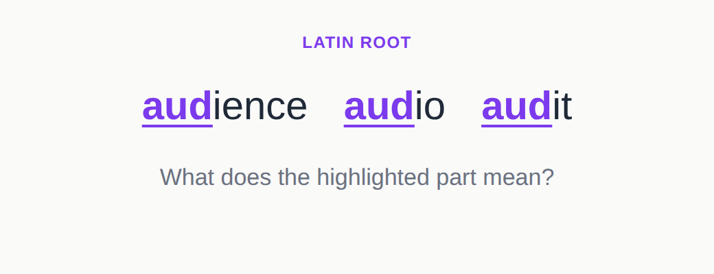
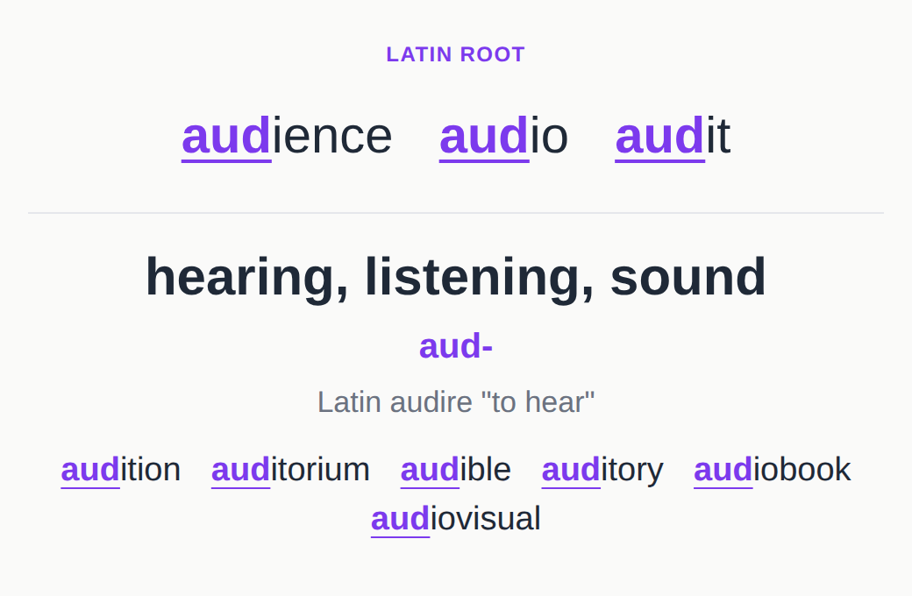
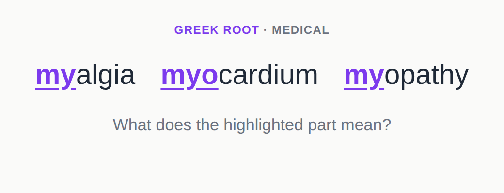
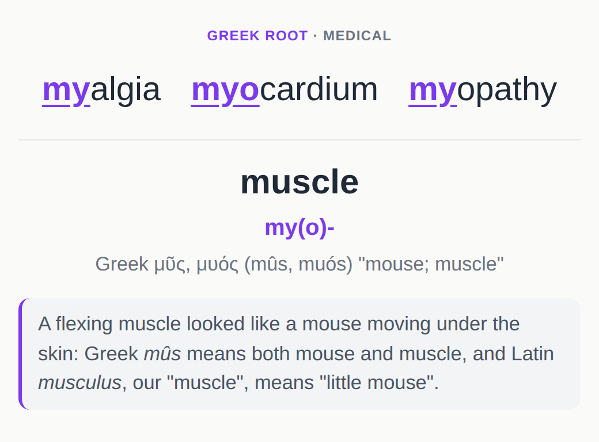
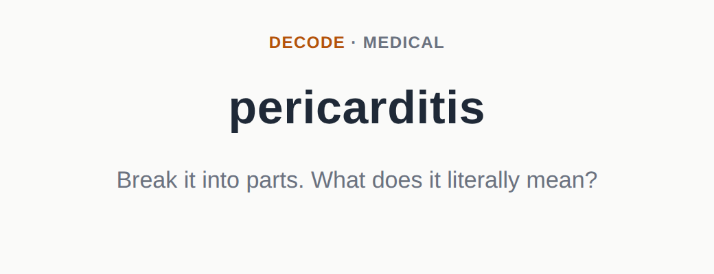
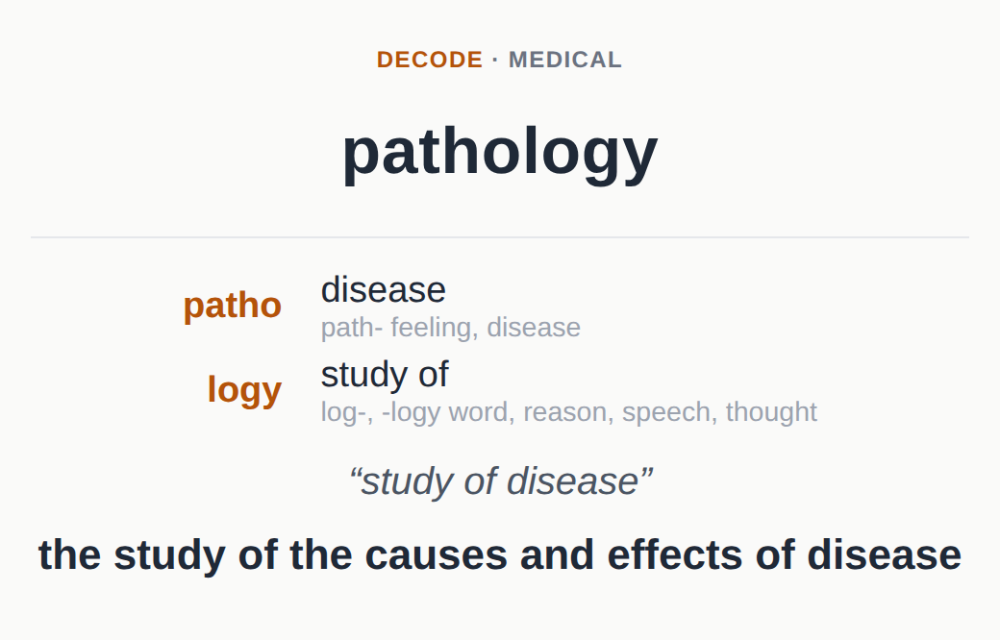

# Word Roots for Anki

An Anki deck of the Greek and Latin prefixes, roots and suffixes that build English words,
including the ones medicine uses. It starts with a core of the most productive, easy-to-spot
morphemes, then continues in order of usefulness; obscure ones aren't included at all.

**[Download Word_Roots.apkg](https://github.com/jupsh/anki-word-roots/releases/latest/download/Word_Roots.apkg)**,
then in Anki choose **File → Import**.

## What's in it

- **700 morphemes:** 573 roots, 74 prefixes and 53 suffixes (437 Latin, 252 Greek). The first
  123 are the core: *re-*, *pre-*, *trans-*, *-able*, *-ity*, *graph*, *phon*, *port*, *dict*…
- **222 decode words** (102 medical) for practising taking words apart. 87 of them never appear
  among the morphemes' example words, so they test the roots rather than recognition.
- **77 etymology stories** for the roots with a good one, such as why *muscle* means "little
  mouse", each with a link to its source.

Each morpheme is taught through words you already know, with the morpheme highlighted. Decode
cards break a word into parts, giving the meaning each part has in that word (*-logy* → "study
of") with the root's broader meaning underneath.

<table>
  <tr><th scope="col" colspan="2">Morpheme</th></tr>
  <tr><th scope="col">Front</th><th scope="col">Back</th></tr>
  <tr>
    <td></td>
    <td></td>
  </tr>
</table>

<table>
  <tr><th scope="col" colspan="2">Morpheme, with a story</th></tr>
  <tr><th scope="col">Front</th><th scope="col">Back</th></tr>
  <tr>
    <td></td>
    <td></td>
  </tr>
</table>

<table>
  <tr><th scope="col" colspan="2">Decode</th></tr>
  <tr><th scope="col">Front</th><th scope="col">Back</th></tr>
  <tr>
    <td></td>
    <td></td>
  </tr>
</table>

## Studying

**Settings.** The deck is designed to be studied in order: core morphemes first, and each decode
card a few cards after the last morpheme it uses. To keep that order, open the deck's options
and, under *Display Order*, set:

- **New card gather order:** *Ascending position*
- **New card sort order:** *Order gathered* (the default, *Card type, then order gathered*,
  would show all of a day's morpheme cards before its decode cards)

Placement only controls when a decode card is first shown: it doesn't wait until you've
mastered its parts.

**Grading.** Count an answer as right if you recall the essential meaning: "see" for *vid-/vis-*,
or "inflammation of the sac around the heart" for *pericarditis*. Exact wording, the root's other
senses and the stories are extras.

**Tags** for [filtered decks](https://docs.ankiweb.net/filtered-decks.html), or for suspending
what you don't need:

| Tag | What it marks |
|---|---|
| `WR::Core` | the first 123 morphemes |
| `WR::Medical` | specialist medical vocabulary: anatomy, diseases, procedures |
| `WR::Medical_Related` | general morphemes medicine also uses heavily (*hyper-*, *-itis*, *neo-*) |
| `WR::Prefix`, `WR::Root`, `WR::Suffix` | the kind of morpheme |
| `WR::Latin`, `WR::Greek` | the language |
| `WR::Decode`, `WR::Story` | decode cards; morphemes with a story |

To skip the specialist medical vocabulary, search `deck:"Word Roots" tag:WR::Medical` and suspend
the results. Everyday decode cards never rely on a specialist morpheme, so nothing else breaks.

## Where the content comes from

The morphemes started from Wikipedia's *List of Greek and Latin roots in English* and *List of
medical roots, suffixes and prefixes*. Entries were kept only if their example words are common
in English, measured with [wordfreq](https://github.com/rspeer/wordfreq), and then reviewed by
hand: wrong meanings fixed, duplicates merged, better example words chosen, and missing suffixes,
prefixes and medical roots added.

Every example word and decode word is also checked against its Wiktionary etymology with
`tools/check_etymology.py`, which flags words whose recorded origin doesn't include the
morpheme's source word. That check caught false connections such as *tribulation* (from
*tribulum*, a threshing sledge, not *tribuere* "to pay") and *ferry* (Germanic, not Latin
*ferre*). Flags are reviewed by hand, since some are the tool's limits rather than errors. The
build separately checks that each highlight sits in the right place, such as a prefix at the start
of the word.

## Building it yourself

Needs [uv](https://docs.astral.sh/uv/).

```sh
uv run python word_roots/build.py                 # writes dist/Word_Roots.apkg
uv run python word_roots/build.py --html out.html # plus an HTML preview of every note
uv run python tools/check_etymology.py            # check example words against Wiktionary
```

The content is three CSV files in `word_roots/data/`: `morphemes.csv` (in study order),
`stories.csv` and `decode.csv`; see [CONTRIBUTING.md](CONTRIBUTING.md) for their formats.
`tools/import_wikipedia.py` generated the first version of `morphemes.csv`. It has been
hand-edited since, so edit the CSV directly. Note GUIDs come from each morpheme's `id` and each
decode word, so keep ids stable.

## Contributing

Spotted a mistake? [Open an issue](https://github.com/jupsh/anki-word-roots/issues). To change
the deck yourself, see [CONTRIBUTING.md](CONTRIBUTING.md).

## License

[CC BY-SA 4.0](LICENSE.md), because the source data comes from Wikipedia. The build code is
public domain.
