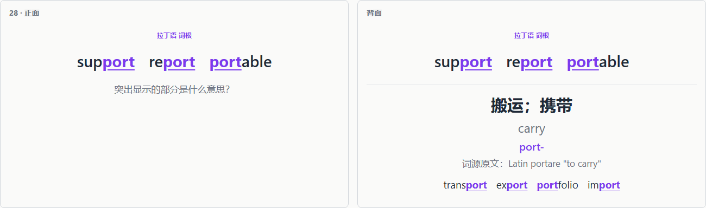
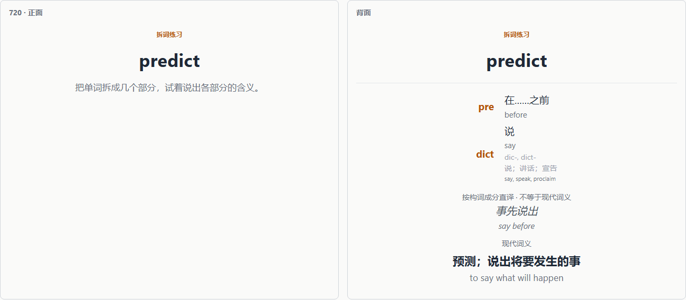

# Word Roots 中文：英语词根词缀 Anki 牌组

以简体中文学习英语中的希腊语、拉丁语词根、前缀和后缀。通过熟悉的英文例词回忆含义，再用完整单词练习拆解。

本项目基于 [jupsh/anki-word-roots](https://github.com/jupsh/anki-word-roots) 汉化，保留英文释义、词源原文和来源链接，方便对照核查。[English / 原版说明](README.en.md)

## 汉化范围

| 内容 | 数量 | 显示方式 |
|---|---:|---|
| 词根、前缀、后缀 | 700 | 中文含义为主，英文释义在下方 |
| 核心词根词缀 | 123 | 保留 `WR::Core` 标签和学习顺序 |
| 拆词练习 | 222 | 各部分含义、构词直译、现代词义均有中文对照 |
| 词源故事 | 77 | 中文译文、英文原文和来源链接 |
| 卡片界面 | 两种卡片 | 中文提示、分类、医学标记与学习说明 |

英文例词及高亮保持原样；拉丁语、希腊语词源原文保留。例词列表不额外添加逐词中文释义，练习重点仍是识别词素。拆词卡提供完整单词的中文含义。

词根卡的正反面：



拆词练习的正反面：



手机宽度的深色模式：[查看词源故事示例](doc/zh-mobile-dark.png)。这些是生成模板的浏览器预览截图，具体 Anki 客户端的字体可能略有差异。

**请区分“构词直译”和“现代词义”。** 历史构词关系不表示现代词义一定能由各部分直接推导。中文是对原版学习材料的翻译，不是对全部词源的独立审定。有关古代医学的故事描述历史观念。

## 获取与导入

文件名为 **`Word_Roots_zh-CN.apkg`**。如果本 fork 的 [Releases](https://github.com/trevanzhang/anki-word-roots/releases) 还没有发布中文版，可从成功的 [Build 工作流](https://github.com/trevanzhang/anki-word-roots/actions/workflows/build.yml) 下载 `Word_Roots` 附件，或按下文在本地生成。GitHub 工作流附件通常需要登录后下载。

在桌面版 Anki 中选择 **文件 → 导入**，打开 `.apkg` 文件，再通过 Anki 同步到手机。

中文版的牌组名称为 **Word Roots 中文**。它使用独立的牌组 ID、笔记类型 ID 和笔记 GUID，可与英文版同时存在；导入中文版不会自动迁移英文版的学习进度。后续中文版更新应保留这些标识。

## 建议的学习方式

1. 先学习 `tag:WR::Core` 下的 123 个核心词根词缀。
2. 不需要专业医学词汇时，在浏览器搜索 `deck:"Word Roots 中文" tag:WR::Medical`，选中结果并暂停。这会同时暂停相关词根卡和医学拆词卡。
3. 保持学习顺序：新卡片收集顺序选 **位置升序（Ascending position）**，新卡片排序选 **按收集顺序（Order gathered）**。Anki 不同版本的中文界面译名可能略有差异。
4. 能回忆核心含义即可判对，不必逐字复述英文、其他义项或词源故事。

拆词卡放在它需要的最后一个词素后面若干张；这种位置安排不代表 Anki 会等到你熟练掌握所有词素才显示它。

标签保持原版英文，方便沿用筛选条件：

| 标签 | 用途 |
|---|---|
| `WR::Core` | 核心词根词缀 |
| `WR::Prefix` / `WR::Root` / `WR::Suffix` | 前缀／词根／后缀 |
| `WR::Medical` | 专业医学词汇 |
| `WR::Medical_Related` | 医学中也常见的一般词素，例如 hyper- |
| `WR::Latin` / `WR::Greek` | 语言来源 |
| `WR::Decode` / `WR::Story` | 拆词卡／带词源故事的卡片 |

## 本地生成

安装 [uv](https://docs.astral.sh/uv/) 后，在项目目录运行：

```sh
# 默认生成中文版
uv run python word_roots/build.py

# 同时生成可直接在浏览器打开的全部卡片正反面预览
uv run python word_roots/build.py --lang zh-CN --html dist/Word_Roots_zh-CN.html

# 仍可生成原版英文牌组
uv run python word_roots/build.py --lang en --html dist/Word_Roots_en.html

# 检查译文完整性、上游变化、生成包和两种版本的独立标识
uv run python -m unittest discover -s tests -v
```

完整牌组写入 `dist/`。`--only` 用于局部校对，生成的局部牌组写入 `build/`，避免混入完整发行文件。

GitHub Actions 会构建中英文两版、运行检查，并上传 `.apkg` 和 HTML 预览。版本标签仍只创建草稿发布，需由维护者检查后发布。

## 内容来源与维护

原版从 Wikipedia 的希腊语、拉丁语及医学词根列表出发，使用 wordfreq 辅助筛选例词，再人工修订；词源检查工具借助 Wiktionary 标记可能的错误。这些过程有助于核查，不保证每条词源都已由专业人员审定。

英文数据位于 `word_roots/data/`，中文版采用独立的 `word_roots/locales/zh-CN.json` 覆盖层。每条译文保存对应英文原文，若上游改变释义或故事，中文构建会报错并要求复核，避免沿用过期翻译。

修改和同步方法见 [汉化维护说明](LOCALIZATION.md)；原版内容规范见 [CONTRIBUTING.md](CONTRIBUTING.md)。

## CrowdAnki

本项目用 CSV 和生成脚本维护内容，不是原生 CrowdAnki JSON 仓库。如需 CrowdAnki，可先把 `.apkg` 导入 Anki，再在“文件 → 导出”选择 **CrowdAnki JSON representation**。本次汉化未增加直接生成 CrowdAnki JSON 的功能。

## 许可与署名

原版：jupsh/anki-word-roots。中文改编：trevanzhang/anki-word-roots。

牌组内容和中文译文继续采用 [CC BY-SA 4.0](LICENSE.md)。原版构建代码为公有领域；新增构建与检查代码同样以公有领域方式提供。在分享修改后的内容时，请保留来源、改编说明与相同许可。
